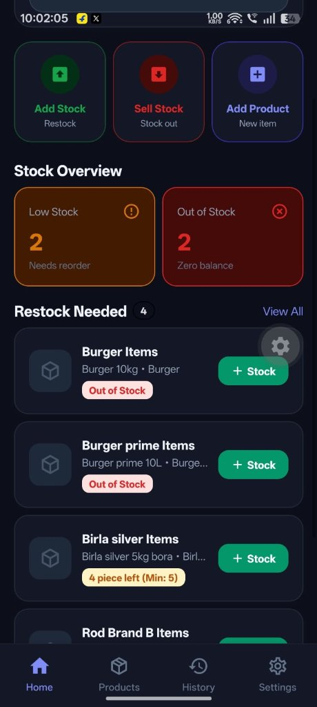
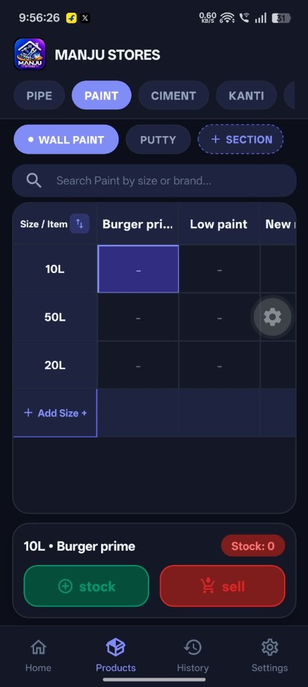

<div align="center">
  
  <h1>MANJU STORES — Stock Management & POS</h1>
  <p><strong>A High-Performance, Offline-First Mobile & Tablet Inventory Management Solution for Hardware, Building Materials, Paints, Pipes & Sanitary Stores.</strong></p>

  <p>
    <a href="https://github.com/RohanShill/stock-management/releases/latest"></a>
    <a href="https://expo.dev"></a>
    <a href="https://reactnative.dev"></a>
    <a href="https://www.typescriptlang.org"></a>
    <a href="https://www.sqlite.org"></a>
    
  </p>

  <h3>
    <a href="https://expo.dev/artifacts/eas/dDN8KIHaCLXIIVt1S1XIyaEW40LM8Dz8x4K1y2eM_U0.apk">📲 Direct Download Android APK (v1.0.0)</a> &nbsp;•&nbsp;
    <a href="https://github.com/RohanShill/stock-management/releases/latest">📦 GitHub Releases</a> &nbsp;•&nbsp;
    <a href="#-quick-start">🚀 Quick Start</a> &nbsp;•&nbsp;
    <a href="#-key-features">✨ Key Features</a>
  </h3>
</div>

---

## 📱 App Showcase

<div align="center">
  <table>
    <tr>
      <td align="center" width="50%">
        <strong>🏠 Home Dashboard & Stock Overview</strong><br/><br/>
        <br/>
        <em>Glowing Low-Stock Alerts & Restock List</em>
      </td>
      <td align="center" width="50%">
        <strong>📦 2D Matrix Table & Quick Actions</strong><br/><br/>
        <br/>
        <em>Interactive Brands vs. Sizes Matrix with 1-Tap Stock / Sell</em>
      </td>
    </tr>
  </table>
</div>

---

## ✨ Key Features

### ⚡ 1. Offline-First SQLite Architecture
- **Instant Response:** Zero network lag during billing, inventory adjustments, and catalog browsing.
- **ACID Transactions:** Powered by `expo-sqlite` with **WAL (Write-Ahead Logging)** mode. Data is always protected even during sudden battery drain or app termination.
- **Full Offline Reliability:** Stores operate completely normally without internet connection throughout the day.

### 📊 2. Interactive 2D Matrix Table
- **Multi-Variant Visualization:** Unique grid layout tailored for hardware stores — **Rows = Sizes** (e.g. 10L, 20L, 50L, 1/2", 1") and **Columns = Brands/Categories** (e.g. Berger Prime, Asian Paints, Supreme Pipe).
- **1-Tap Quick Action Bar:** Select any cell in the table to immediately restock (`+ Stock`) or record sales (`Sell Out`) without navigating through complex sub-menus.
- **Dynamic Category & Section Tabs:** Fast switching between product departments (`PIPE`, `PAINT`, `CIMENT`, `KANTI`, etc.).

### 🔔 3. Intelligent Stock Overview & Low-Stock Alerts
- **Live Inventory Cards:** High-contrast summary cards showing total **Low Stock** and **Out of Stock** items.
- **Restock Needed Feed:** Immediate actionable list showing current quantity left, minimum safety threshold, and 1-tap restock shortcut.

### 📱 4. Android Phone & Tablet Optimized
- **Dual Form-Factor Support:** Fluid responsive layout with auto-rotation support (`default` orientation) for Android billing tablets and counter mobile phones.
- **Safe Ergonomics:** Built-in bottom navigation padding tuned to prevent gesture navigation pill interference (matching modern WhatsApp/Telegram ergonomics).
- **Theme Support:** Polished Dark Mode and clean Light Mode with high-contrast accessibility buttons.

### 🧾 5. Parties & Khata Ledger (CRM)
- **Customer & Supplier Accounts:** Track ledger balances, total receivables, and payables.
- **Transaction History:** Link sales and restocks to specific parties with remaining credit balance calculations.

### 📜 6. Full Transaction Audit & Filtered History
- **12-Hour Timestamps:** Exact date and time tracking (e.g., `10:02 PM`) for all stock entries and sales.
- **Calendar & Quick Filters:** Filter activity by `Today`, `Yesterday`, `Last 7 Days`, or custom date range calendar picker.

### 🧮 7. Hardware Domain Calculation Engine
- **Pipe Cutting Best-Fit Algorithm:** Buy pipes in bulk lengths (e.g. 3m) and sell fractional cuts (e.g. 7.5m). The engine searches for usable remnants first before cutting into fresh whole pipes.
- **Integer Paise Precision:** Financial totals and GST calculations use integer Paise (₹ 1 = 100 paise) to eliminate JavaScript floating-point errors.
- **GST Breakdown:** Automatic CGST/SGST splits and nearest-rupee round-off adjustments.

### 🔄 8. Background Cloud Synchronization
- **Outbox Sync Engine:** Changes made offline are queued with unique client UUIDs in a local `sync_queue`.
- **Idempotent Replay:** Cloud API validates operation tokens to ensure retries never duplicate transactions or double-deduct inventory.
- **Incremental Cursors:** Cloud pulls use high-water mark timestamps (`server_cursor`) to sync only modified records.

---

## 🏗️ Monorepo Structure

```
hardware-store-manager/
├── .github/
│   └── workflows/
│       └── build-apk.yml     # GitHub Actions automated signed Android APK build & release
├── apps/
│   └── mobile/              # React Native + Expo Android app (Phones & Tablets)
│       ├── app/             # Expo Router screens (tabs, modals, auth)
│       │   ├── (tabs)/      # Home, Products (Matrix), History, Settings
│       │   └── _layout.tsx  # Root navigation stack & splash screen handler
│       ├── src/
│       │   ├── database/    # SQLite tables, WAL migrations, repositories
│       │   ├── store/       # Zustand reactive state store
│       │   ├── sync/        # Offline Sync Engine (Queue & Cursor pull)
│       │   └── tests/       # Mobile unit & integration tests (32 tests)
│       ├── assets/          # App icons, adaptive icons, splash screens
│       ├── eas.json         # Expo Application Services build configuration
│       └── app.json         # Android manifest, versionCode, permissions
├── services/
│   └── api/                 # Express.js + Mongoose cloud backend
│       ├── src/
│       │   ├── models/      # MongoDB schemas (Product, Sale, Party, Movement)
│       │   ├── routes/      # REST API v1 endpoints
│       │   └── middleware/  # JWT auth, role validation, idempotency
│       └── .env.example
├── packages/
│   └── shared/              # Shared TypeScript domain logic & validation
│       └── src/
│           ├── types/       # Units, Pipe Math, Money (Paise), Sync
│           ├── schemas/     # Zod data validation schemas
│           └── utils/       # SKU generator, pipe cutting algorithms
├── docs/                    # Architectural specs, schema designs, screenshots
└── package.json             # Root npm workspaces configuration
```

---

## 🛠️ Technology Stack

| Layer | Technologies |
|---|---|
| **Mobile App** | React Native `0.76.6`, Expo SDK `52`, Expo Router `v4`, `expo-sqlite` `v15` (WAL), React Native Paper `v5`, Zustand `v5`, Lucide Icons |
| **Backend API** | Node.js `v20+` / `v24`, Express `4.21`, Mongoose `8.9` (MongoDB Atlas), Zod `3.24`, Helmet, JWT, bcryptjs |
| **Shared Core** | TypeScript `5.7` Strict Mode, Vitest `v3` |
| **CI / CD** | GitHub Actions (`build-apk.yml`), Expo EAS Build (Preview APK & Production AAB) |

---

## 🚀 Quick Start

### 1. Prerequisites
- **Node.js:** `v18+` (tested on Node `v20` and `v24`)
- **npm:** `v10+`
- **MongoDB:** MongoDB Atlas connection string or local MongoDB instance

### 2. Installation & Build Shared Packages
```bash
# Clone the repository
git clone https://github.com/RohanShill/stock-management.git
cd stock-management

# Install dependencies and compile shared domain library
npm install
npm run build:shared
```

### 3. Run Automated Tests
```bash
npm test
```
*Executes all 50 automated tests across domain math, API endpoints, SQLite tables, and the 2D Matrix engine.*

### 4. Start Backend API
```bash
cd services/api
cp .env.example .env
npm run dev
```
API runs at `http://localhost:4000/api/v1` with a health check at `http://localhost:4000/health`.

### 5. Start Mobile App in Development
```bash
cd apps/mobile
npx expo start -c
```
- Press `a` to open on a connected Android device or emulator.
- Or scan the terminal QR code using **Expo Go** on your Android device.

---

## 🧪 Automated Test Suite (50 Passing)

The project includes strict automated test suites across every layer of the monorepo:

```
Test Suites:
 ✓ packages/shared/src/tests/domain.test.ts        (13 tests passed)
   - Canonical millimetre unit conversions
   - Fractional pipe cutting & remnant allocation
   - Monetary integer Paise calculations & GST splits
   - Dynamic SKU generation & invoice round-off

 ✓ services/api/src/tests/api.test.ts              (5 tests passed)
   - Health check endpoint
   - Unauthorized access prevention
   - JWT authentication lifecycle

 ✓ apps/mobile/src/tests/matrix.test.ts           (14 tests passed)
   - Matrix grid row & column derivation
   - Size normalization & unit matching
   - Quick-action stock increment & decrement

 ✓ apps/mobile/src/tests/repositories.test.ts     (9 tests passed)
   - SQLite CRUD operations on Products & Parties
   - Outbox sync queue enqueue & status tracking

 ✓ apps/mobile/src/tests/demo.test.ts             (6 tests passed)
   - Factory sample reset & security boundary isolation

 ✓ apps/mobile/src/tests/mobile.test.ts           (3 tests passed)
   - Schema validation & English/Hindi locale lookups

Total: 50 / 50 Tests Passed (100% Success Rate)
```

---

## 📦 Building Standalone Android APK

### Option A: GitHub Actions (Recommended — Free & Automated)
The repository includes a pre-configured GitHub Actions CI/CD workflow ([`.github/workflows/build-apk.yml`](.github/workflows/build-apk.yml)).

- **1-Click Manual Build:**
  1. Open the repository on GitHub.
  2. Navigate to the **Actions** tab.
  3. Select **"Build & Release Android APK"** and click **Run workflow**.
- **Automated on Git Tag:**
  Push any version tag to trigger an automatic compile and GitHub Release:
  ```bash
  git tag v1.0.1
  git push origin v1.0.1
  ```
- **Permanent Client Download URL:**
  Client can download the latest standalone APK directly from:  
  👉 **`https://github.com/RohanShill/stock-management/releases/latest`**

### Option B: Expo EAS Cloud Build
```bash
cd apps/mobile

# Fast Standalone APK (arm64-v8a optimized, ~28 MB):
npx eas-cli build -p android --profile preview

# Production Google Play Store App Bundle (AAB):
npx eas-cli build -p android --profile production
```

---

## 🔐 Client Evaluation Demo Mode

For conducting safe demonstrations and client evaluations without exposing live databases:
- **Application ID:** `com.hardwarestore.manager.demo`
- **Database:** Isolated SQLite database (`hardware_store_demo.db`).
- **Safety Policy:** Cloud sync is strictly disabled by code policy in Demo Mode.
- **1-Tap Reset:** Safe factory reset button in Settings instantly re-populates pristine sample hardware inventory.
- For complete details, see [docs/DEMO_BUILD.md](docs/DEMO_BUILD.md).

---

## 📄 License & Maintainer

Developed by **Rohan Shill** for **MANJU STORES**.  
All rights reserved. Distributed under the MIT License.
